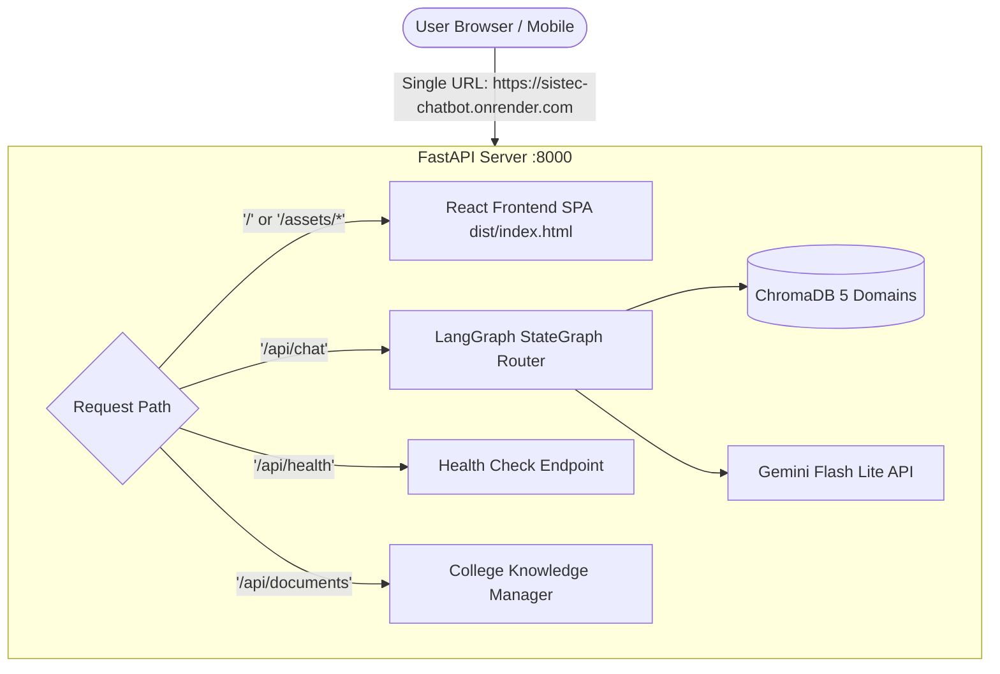

# 🚀 SISTec RAG Chatbot - Option 1: All-in-One Single Container Deployment Guide

This guide details the complete deployment steps for the **All-in-One Single Container** architecture (React Frontend + FastAPI Multi-Domain RAG Backend packaged into a single deployable unit).

---

## 🏗️ Architecture Overview



### Key Advantages:
1. **Single Public URL:** Frontend and Backend share the same origin (e.g., `https://sistec-chatbot.onrender.com`).
2. **Zero CORS Issues:** Relative fetch calls (`/api/chat`, `/api/documents`) eliminate cross-origin request headers and preflight lag.
3. **Zero Maintenance:** Auto-deploys on every `git push origin main`.
4. **Self-Bootstrapping Knowledge Base:** On first container start, FastAPI automatically ingests all 90 college files from `data/` into ChromaDB.

---

## 🌐 Option A: Deploy on Render (Recommended - Free Tier)

### Method 1: Using Render Blueprint (`render.yaml`)
1. Push your latest code to GitHub:
   ```bash
   git add .
   git commit -m "feat(deploy): setup all-in-one container deployment"
   git push origin main
   ```
2. Log in to [Render Dashboard](https://dashboard.render.com/).
3. Click **New +** -> **Blueprint**.
4. Select your repository `sagar-chat-bot` (or `Minor`).
5. Render reads `render.yaml` automatically:
   - **Service Name:** `sistec-rag-chatbot`
   - **Runtime:** `Docker`
   - **Plan:** `Free`
   - **Health Check Path:** `/api/health`
6. Under **Environment Variables**, provide your `GEMINI_API_KEY`:
   - Key: `GEMINI_API_KEY`
   - Value: `AIzaSy...` (your Google Gemini API key)
7. Click **Apply Blueprint**.
8. Render will build the Docker container and provide your live URL (e.g., `https://sistec-rag-chatbot.onrender.com`).

---

### Method 2: Manual Web Service Setup on Render
1. In [Render Dashboard](https://dashboard.render.com/), click **New +** -> **Web Service**.
2. Connect your GitHub repository.
3. Configure the service settings:
   - **Name:** `sistec-rag-chatbot`
   - **Region:** `Singapore` (or closest to India)
   - **Branch:** `main`
   - **Runtime:** `Docker`
   - **Dockerfile Path:** `./Dockerfile`
   - **Instance Type:** `Free`
4. Under **Environment Variables**, add:
   - `GEMINI_API_KEY` = `<your-gemini-api-key>`
   - `LLM_MODEL` = `gemini-flash-lite-latest` (Optional, defaults to this)
5. Under **Advanced Settings**:
   - **Health Check Path:** `/api/health`
6. Click **Create Web Service**.

---

## 🚂 Option B: Deploy on Railway (Alternative)

1. Log in to [Railway](https://railway.app/).
2. Click **New Project** -> **Deploy from GitHub repo**.
3. Select your repository.
4. Railway will automatically detect the root `Dockerfile`.
5. Go to **Variables** tab and add:
   - `GEMINI_API_KEY` = `<your-gemini-api-key>`
6. Go to **Settings** -> **Networking** -> click **Generate Domain**.
7. Railway gives you a public HTTPS URL with no sleep timeouts!

---

## 🤗 Option C: Deploy on Hugging Face Spaces (Free Docker Tier)

1. Go to [Hugging Face Spaces](https://huggingface.co/spaces) and click **Create new Space**.
2. Choose **Docker** as the Space SDK (Blank template).
3. Set Space visibility to **Public**.
4. In Space Settings -> **Repository Secrets**, add:
   - `GEMINI_API_KEY` = `<your-gemini-api-key>`
5. Push this repository to Hugging Face or sync from GitHub.
6. Hugging Face will build the container and host it with 16 GB RAM for free!

---

## 💻 Local Container Execution (Docker / Docker Compose)

To test the container locally exactly as it runs in the cloud:

```bash
# Using Docker Compose
docker-compose up --build

# Or using plain Docker CLI:
docker build -t sistec-rag-chatbot .
docker run -p 8000:8000 -e GEMINI_API_KEY="your-gemini-key" sistec-rag-chatbot
```

Open your browser at `http://localhost:8000` to interact with the full chatbot!

---

## 🔍 Verification & Health Check

Once deployed, you can verify your service status via:

| Endpoint | Method | Description |
| :--- | :--- | :--- |
| `/` | `GET` | React Single Page Application UI |
| `/api/health` | `GET` | Health status, LangGraph state, domain count |
| `/api/documents` | `GET` | All 90 indexed college documents & chunk stats |
| `/api/chat` | `POST` | Multi-domain RAG chat query |
